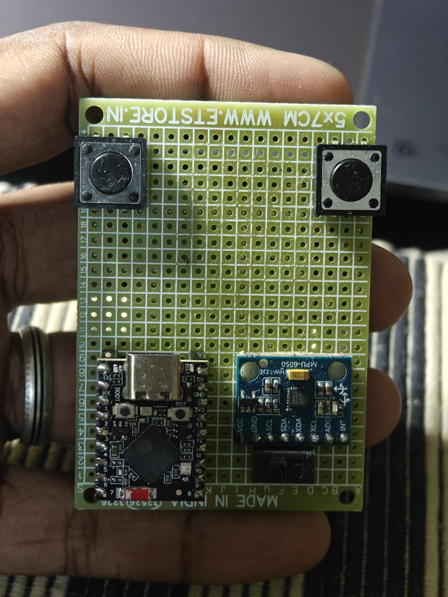
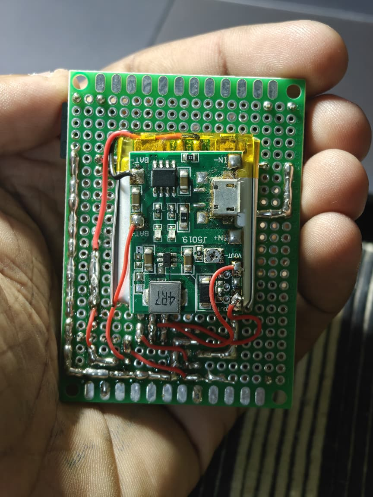
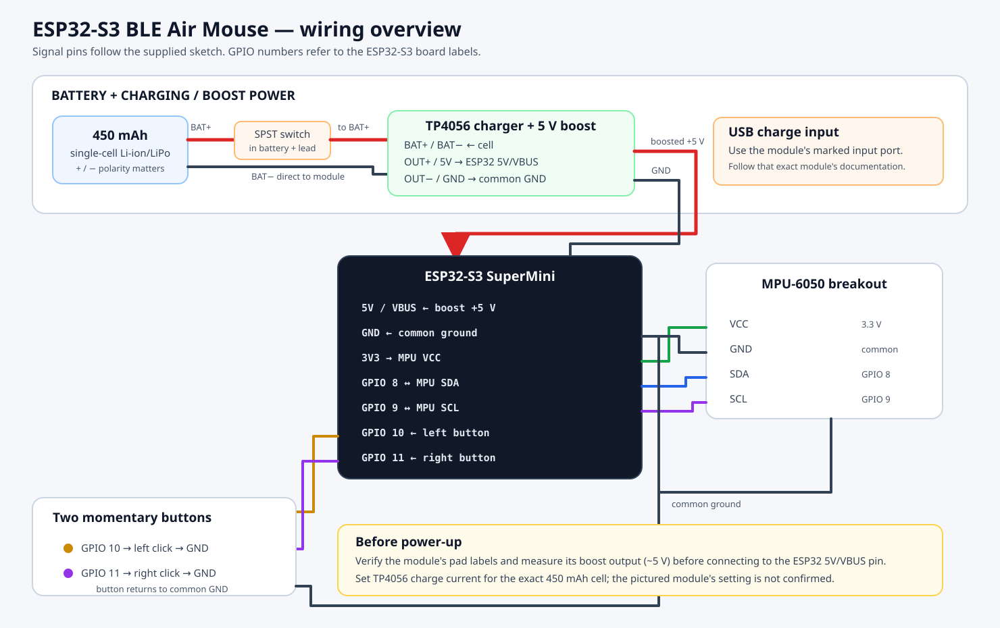

# ESP32-S3 BLE Air Mouse

A handheld Bluetooth Low Energy air mouse built around an **ESP32-S3 SuperMini**, an **MPU-6050** motion sensor, and two push buttons. Tilting the board moves the pointer; the buttons send left and right clicks.

The build is powered by a **450 mAh single-cell Li-ion battery** and the pictured TP4056-based charging/5 V boost module. See the wiring and battery notes before assembling or charging it.

## What it does

- Advertises as **Soorya Air Mouse** over Bluetooth LE.
- Uses gyro X/Y readings from the MPU-6050 to move the pointer.
- Uses a low-pass filter, gyro dead zone, and per-update movement limit to reduce jitter.
- Sends a left click from the button on GPIO 10 and a right click from the button on GPIO 11.
- Calibrates gyro bias at startup; keep the device still during calibration.

The sketch reports a fixed BLE battery level of 100%; it does **not** measure the actual battery voltage or state of charge.

## Parts

| Part | Notes |
| --- | --- |
| ESP32-S3 SuperMini | Use the board's labeled 5 V/VBUS input for the boost output and its 3V3 pin for the sensor. Board revisions can differ. |
| MPU-6050 breakout | The pictured module is labeled `MPU-6050`; the sketch uses I²C address `0x68`. |
| 2 momentary push buttons | Each button connects its GPIO input to ground when pressed. |
| 450 mAh single-cell Li-ion/LiPo battery | Observe polarity and the cell maker's charge-current limit. |
| TP4056-based charger + 5 V boost module | The pictured module combines charging and boost output. Check its pad labels and charge-current setting. |
| SPST power switch | Wired in series with battery positive as described in the supplied build. |
| Perfboard, wire, solder, enclosure/handle | As needed for your layout. |

## Wiring

### Wiring diagram

See [wiring notes](docs/wiring.md) for module, power, and safety details.

| Connection | ESP32-S3 / module |
| --- | --- |
| MPU SDA | GPIO 8 |
| MPU SCL | GPIO 9 |
| MPU VCC | ESP32 3V3 |
| MPU GND | Common GND |
| Left button | GPIO 10 to GND |
| Right button | GPIO 11 to GND |
| Boost output +5 V | ESP32 pin marked 5V or VBUS (confirm the board label) |
| Boost output GND | ESP32 GND and common GND |
| Battery + | Through the switch to module `BAT+` |
| Battery − | Module `BAT−` |

Unused MPU breakout pins (`XDA`, `XCL`, `AD0`, and `INT`) are not connected in this build. The code expects address `0x68`.

> **Battery safety:** Do not assume a TP4056 module's default charging current is suitable for a 450 mAh cell. Check the cell specification and the module's programmed current before charging. Confirm that the module provides the protection your cell requires. Never rely on the ESP32's 5 V pin as a battery charger.

## Build and flash

1. Install the Arduino IDE and the Espressif **esp32** board package.
2. Install an ESP32-S3-compatible BLE mouse library that provides `BleMouse.h` and the API used by this sketch. The [ESP32-S3 BLE Mouse library](https://github.com/mayermakes/ESP32-s3-BLE-Mouse) is one compatible option; its README describes ZIP installation.
3. Open [`firmware/air_mouse.ino`](firmware/air_mouse.ino).
4. Select **ESP32S3 Dev Module** (or the matching SuperMini entry if your board package provides one). Select the USB/Upload options appropriate for your board and port.
5. Upload the sketch. If normal upload fails, put the board into download mode with its BOOT/RESET buttons and retry.
6. Open Serial Monitor at **115200 baud**. On boot, the sketch waits, checks the MPU, and prints a gyro calibration prompt. Keep the mouse completely still until calibration finishes.
7. Pair the computer/tablet with **Soorya Air Mouse** in its Bluetooth settings.

Espressif's current Arduino guide describes ESP32-S3 USB CDC and DFU settings; board variants differ, so use the upload mode that matches your SuperMini's USB wiring: [USB CDC and DFU flashing](https://docs.espressif.com/projects/arduino-esp32/en/latest/tutorials/cdc_dfu_flash.html).

## Use and tune

Hold the board in the same orientation shown in the front photo, then tilt it to move the pointer. The exact axis directions depend on how the MPU is mounted. If movement is reversed or swapped, adjust the `mouseX` and `mouseY` mapping in `processGyro()`.

The main tuning values are near the top of the sketch:

| Setting | Default | Effect |
| --- | ---: | --- |
| `CURSOR_SENSITIVITY` | `0.28` | Pointer speed; increase for faster movement. |
| `GYRO_DEADZONE` | `3.0` | Small motion ignored to limit drift. |
| `MAX_MOUSE_MOVE` | `8` | Maximum reported movement per loop update. |
| `SMOOTHING_ALPHA` | `0.12` | Lower is smoother but more delayed; higher is more responsive but can jitter. |
| `CALIBRATION_SAMPLES` | `1500` | Number of still gyro readings used at startup. |

The buttons use `INPUT_PULLUP`; pressing a button should pull GPIO 10 or 11 to ground. The current sketch detects the press edge and does not implement software debounce.

## Troubleshooting

| Symptom | Check |
| --- | --- |
| `MPU not responding at 0x68` | Check 3V3, common ground, SDA on GPIO 8, SCL on GPIO 9, and the breakout's I²C address. Some boards expose address `0x69` when AD0 is high; this sketch is fixed at `0x68`. |
| Pointer drifts after startup | Reboot on a stable surface and hold the device still through calibration. Increase `GYRO_DEADZONE` slightly if needed. |
| Pointer moves on the wrong axis/direction | Adjust signs or swap X/Y in the `mouseX` / `mouseY` mapping. |
| Buttons do not click | Verify each button shorts its GPIO to GND when pressed; confirm the left/right GPIO assignment. |
| Bluetooth device is not visible | Check that `bleMouse.begin()` is reached after successful MPU initialization and calibration; check the Serial Monitor. |
| ESP32 resets when moving or connecting | Measure the boost module output under load, check wiring and ground, and make sure the module can supply the ESP32-S3's current peaks. |
| Battery does not charge or gets hot | Disconnect it. Recheck polarity, cell compatibility, protection, and the charger current setting before trying again. |

## Repository map

- `firmware/air_mouse.ino` — sketch supplied for this build.
- `docs/wiring.svg` — wiring overview.
- `docs/wiring.md` — pin mapping and battery/module details.
- `docs/build-and-use.md` — expanded assembly and operating steps.
- `docs/troubleshooting.md` — diagnosis checklist.
- `photos/` — the two user-supplied build photos.

## References

- [Espressif Arduino ESP32-S3 USB flashing guide](https://docs.espressif.com/projects/arduino-esp32/en/latest/tutorials/cdc_dfu_flash.html)
- [ESP32-S3 BLE Mouse library](https://github.com/mayermakes/ESP32-s3-BLE-Mouse)
- [TDK/InvenSense MPU-6000/MPU-6050 product specification](https://invensense.tdk.com/wp-content/uploads/2015/02/MPU-6000-Datasheet.pdf)
- [TP4056 datasheet (manufacturer)](https://www.toppwr.com/uploadfile/file/20240307/65e993d6379ea.pdf)

## License`r`n`r`nThis project is licensed under the [MIT License](LICENSE).

