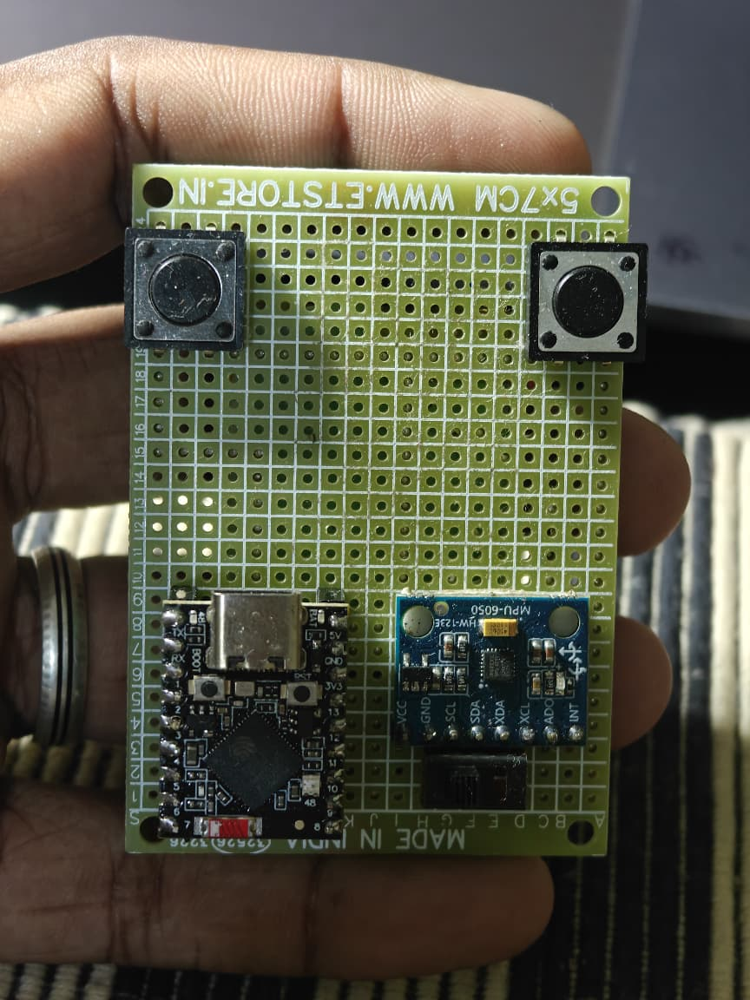

# ESP32-S3 BLE Air Mouse

Native ESP-IDF firmware for an ESP32-S3 SuperMini, MPU-6050, two buttons and a mechanical rotary encoder scroll wheel. Advertises as **Soorya Air Mouse**. No Arduino core or Arduino libraries are required.



## Wiring

| Connection | GPIO / power |
| --- | --- |
| MPU SDA / SCL | 8 / 9 |
| MPU VCC / GND | 3V3 / common GND |
| Left / right button | 10 / 11, each to GND |
| Encoder A (CLK) / B (DT) | 12 / 13 |
| Encoder common | GND |
| Encoder module VCC, if required | 3V3 only |

GPIO 12 and 13 were unused in the original build; confirm they are exposed on your board revision. Inputs use internal pull-ups. Encoder push switch is unused. Use a bare mechanical quadrature encoder or a module with 3.3 V-compatible outputs. Swap A and B to reverse scrolling. The decoder emits one wheel step per four transitions; encoders with other detent patterns may need a different threshold in `main/air_mouse.c`.

The existing [wiring diagram](docs/wiring.svg) shows the original sensor, buttons and power circuit; add the encoder using the table above. See [power wiring notes](docs/wiring.md). Feed the boost output to the board's marked 5V/VBUS input, never 3V3. Check battery polarity, protection and charger current against the 450 mAh cell specification before charging.

## Build and flash with ESP-IDF

Use **ESP-IDF v5.2.8** with its ESP32-S3 toolchain installed. Open an ESP-IDF terminal (on Windows, ESP-IDF Command Prompt); on Linux/macOS source your IDF installation's `export.sh` first. From the repository root:

```sh
idf.py set-target esp32s3
idf.py build
idf.py -p COM5 flash monitor
```

Replace `COM5` with your device port, such as `/dev/ttyACM0` or `/dev/ttyUSB0`. Exit the monitor with Ctrl+]. If flashing fails, hold BOOT, tap RESET, release BOOT and retry. Reset after flashing if necessary. The default console uses UART0 at 115200 baud; if your board exposes only native USB, select USB Serial/JTAG under `idf.py menuconfig` ? Component config ? ESP System Settings ? Channel for console output, rebuild and flash. A UART adapter is another option.

Keep the device still during startup calibration (1500 samples, plus a two-second settling delay). Wait for `Ready: Soorya Air Mouse`, then pair in the host Bluetooth settings. Remove an old pairing before pairing this migrated firmware if the host cached the old HID descriptor. Bond data persists in NVS; `idf.py -p COM5 erase-flash` clears it and all other saved flash data, then flash again.

## Operation and tuning

Tilt to move the pointer, hold the left or right button to click/drag, and rotate the encoder to scroll vertically. Buttons have approximately 20 ms debounce. Motion is sampled approximately every 5 ms; encoder inputs are polled approximately every 1 ms, so very fast rotation can lose steps. I2C timeouts can also delay polling. Hardware behavior still needs verification on the assembled device.

Edit `main/air_mouse.c` to tune `SENSITIVITY` (0.28), `DEADZONE` (3 degrees/s), `ALPHA` (0.12), calibration sample count or axis signs. Movement is limited to +/-8 per report. I2C errors abort calibration; runtime read errors suppress that motion sample. The sensor address is 0x68; compatible clones are not rejected by WHO_AM_I. No actual battery measurement is implemented.

## Layout

- `main/air_mouse.c`: sensor, calibration, input handling and BLE HID mouse report.
- `main/esp_hid_gap.c` and `.h`: Espressif ESP-IDF v5.2.8 HID example GAP helper, retained under its original Unlicense/CC0 license headers.
- `sdkconfig.defaults`: BLE Bluedroid and FreeRTOS defaults.
- `docs/`, `photos/`: assembly notes and original build images.

[ESP-IDF ESP32-S3 getting started](https://docs.espressif.com/projects/esp-idf/en/v5.2.8/esp32s3/get-started/index.html)

Licensed under [MIT](LICENSE), except the attributed Espressif helper files.
